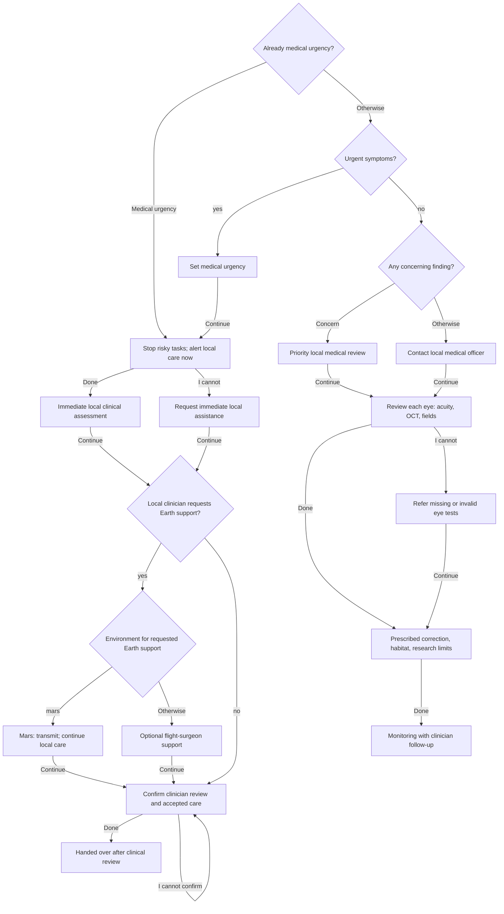
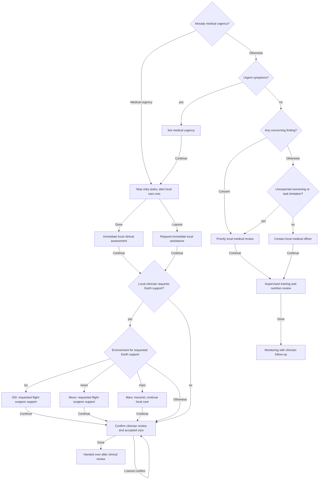

<!-- AI-assisted: generated with Codex; human review by Edu pending. -->

# Regenerated treatment flowcharts (#137)

These diagrams are generated from `config/protocols/sans.json` and
`config/protocols/muscle_atrophy.json`. The app draws those same executable JSON
flows through `protocol_engine.flowchart_dot()`. The diagrams below show full
paths; the app's default focused chart shows the current step and nearby choices.

## Decisions confirmed by Edu

- Local crew medical officer first in every urgent route; the stop action also
  says to alert the officer immediately. Earth support is optional and follows
  a local clinician's request, including on the Moon and for SANS. This broader
  routing is a team workflow choice, not an inferred treatment rule from the PDF.
- Replace the repeated review/wait cycle with one handover-acceptance task.
  `I can't` leaves that same task active; only `Done`, explicitly confirming
  clinician review and accepted responsibility, ends as `handed_over`.
  This is a crew acknowledgement, not authenticated clinician sign-off.
- Review corrected monocular acuity results from Check-in rather than force two
  new protocol measurements. Missing tests are referred, not treated as normal.
- Keep supervised management and a clearly labelled research/clinician-only
  treatment-limit section. No doses, device settings or medical waits are added.
- Keep the Mars flight-surgeon branch as optional Earth support. This does not
  replace Gonzalo's approved a1/ISS watch demonstration or authorize a clinical
  shortcut for presentation timing.

Both ordinary watch paths are at most five displayed steps, counting the end
message and omitting automatic decision/severity nodes. The muscle routine path
has four user responses plus its endpoint; its priority-finding path is shorter.
Missing-data and urgent-assistance paths can be longer because they require
medical assessment. Ending in `monitoring` means follow-up, not cure; ending in
`handed_over` transfers responsibility after review, not resolution of urgency.

## SANS

## Muscle atrophy

## Treatment coverage against the supplied PDF

Primary source: `guia_tratamientos_vigilancia_urgencia.pdf`, 2026-11-14,
SHA-256 `7570681f75f3bed1320c607f0ad2d7387f832862397793e9069a8a0c03eae700`.
Its two-state triage and flow composition are explicitly prototype proposals,
not an official NASA treatment algorithm. The PDF's embedded implementation
suggestions do not override repository contracts; no `priority_review` field is
introduced.

| Pathology / source section | Covered management or limitation | Executable nodes |
| --- | --- | --- |
| Muscle, p. 1, watch management | Individualized resistive and aerobic exercise; load, technique and recovery reviewed with an exercise specialist. | `w_exercise` |
| Muscle, p. 1, nutrition | Review energy and protein against the approved plan; no autonomous supplements or medicines. | `w_exercise`, `w_end` |
| Muscle, p. 1, monitoring and rehabilitation | Daily symptom/training records, comparable strength tests when indicated, and progressive prescribed rehabilitation after return. | `w_end` |
| Muscle, p. 1, avoid | No self-increased loads, painful training, catch-up overload or maximal retesting in an acute event. | `w_exercise`, `w_end`, `u_stop` |
| Muscle, p. 1, urgency | Sudden/progressive weakness, unsafe movement/egress, intense pain; breathing difficulty/unconsciousness are general emergencies. Assess/stabilize and investigate other acute causes; exercise cannot rescue the event in minutes. | `w_red_flags`, `u_stop`, `u_local` |
| Muscle, p. 1, environments | Local care first; requested remote support on ISS, habitat care/conditional transfer on Moon, local pre-authorized care and asynchronous transmission on Mars. Broader optional Earth contact is an Edu-approved workflow decision. | `u_local`, `u_support`, `u_env`, `u_orbit`, `u_moon`, `u_mars_send`, `u_end` |
| SANS, p. 2, assessment | Clinician review of separate-eye corrected acuity and baseline, OCT/fields when available; explicit missing-data referral. No new acuity acquisition is forced in the short route. | `w_acuity`, `w_missing_data` |
| SANS, p. 2, optical management | Use prescribed correction, including prescribed space-anticipation glasses; restored focus does not prove structural recovery. Review sleep/habitat conditions through their procedures. | `w_correction` |
| SANS, p. 2, research / pharmaceutical limits | LBNP, thigh cuffs, supplements and acetazolamide are research or clinician-only options; no established rescue drug is supplied by the guide. No automatic drugs, pressure manipulation or invasive eye procedures. | `w_correction`, `w_end` |
| SANS, p. 2, urgent assessment | New field defect, central distortion, unavailable necessary correction, sudden visual loss, intense eye pain or severe headache with neurological signs: stop risky tasks/EVA, local ocular/neurological assessment, consider other causes. | `w_red_flags`, `u_stop`, `u_local` |
| Both, pp. 1-2, priority review | Concerning numerical finding alone does not create urgency; muscle unexpected worsening/task limitation also requests priority local review. | `w_concern`, `w_limits` (muscle), `w_priority_review` |
| Both, pp. 1-2, handover | Stay assisted and retain urgency until clinician review/acceptance. Transfer, restrictions and eventual rehabilitation belong to the medical team; handover is neither cure nor automatic EVA/return authorization. | `u_handover`, `u_end` |

These cover the management categories in this PDF. They are not an exhaustive
catalogue of every therapy for every possible cause of weakness or visual loss.
A clinician chooses diagnosis-specific treatment; no generic drug doses,
exercise prescription, device settings, medical follow-up interval, automated
transfer or medication-selection menu is generated.

The guide's public references (full extraction in
[MEDICAL_SOURCE_REVIEW.md](MEDICAL_SOURCE_REVIEW.md)):

1. [NASA Exercise Overview](https://www.nasa.gov/ochmo-tb-031-exercise-overview-2/): supervised exercise and ACERS.
2. [NASA Human Adaptation to Spaceflight: The Role of Nutrition](https://www.nasa.gov/wp-content/uploads/2024/10/human-adaptation-to-spaceflight-the-role-of-nutrition.pdf): energy/protein context, not app-generated doses.
3. [NASA Astronaut Health Care in Space](https://www.nasa.gov/missions/station/faq-the-real-story-about-astronaut-health-care-in-space/): care/return context.
4. [Canadian Space Agency Return and Reconditioning](https://www.asc-csa.gc.ca/eng/youth-educators/activities/fitness-and-nutrition/return-and-reconditioning.asp): educational rehabilitation context.
5. [NASA OCHMO-MTB-001](https://www.nasa.gov/wp-content/uploads/2024/02/ochmo-mtb-001-sans.pdf), printed pp. 12-13: correction, research countermeasures and limits of medication evidence. Not individualized clinical instructions.
6. [Gew et al., SANS consensus](https://pmc.ncbi.nlm.nih.gov/articles/PMC13462731/), DOI 10.1038/s41433-026-04651-6: cited by the supplied guide. This task does not claim a new independent full-text verification of the consensus or add recommendations beyond the guide.
7. [NASA Hazard: Distance From Earth](https://www.nasa.gov/hrp/hazard-distance-from-earth/): delayed remote support and the need for local capability.

## Validation and integration boundaries

- Execute watch/concern and unexpected-task-limitation paths in ISS/Moon/Mars;
  confirm one local contact and no mandatory Earth call, urgency escalation or
  new measurement on the ordinary watch path.
- Execute already-urgent and newly escalated paths, both stop-action responses,
  and both optional-Earth responses in every environment. Repeated inability
  to confirm handover and reloads must keep the same task active. Clinical
  acceptance ends `handed_over`, retaining `medical_urgency` severity.
- Execute the SANS missing/invalid-results route. It refers the missing tests
  instead of assuming a normal result or closing automatically.
- Full diagrams must include all executable nodes/edges, with no unreachable
  nodes or unexpected cycles. The only allowed cycle is the intentional
  `I cannot confirm` self-edge on the one handover task; it consumes a user
  response and is not an automatic or alternating review/wait loop.

[Issue #141](https://github.com/ansel-07/nasa-health-monitor/issues/141) tracks
Javi's separate fix: current local-contact cards display Earth round-trip delay.
Local care is immediate; an Earth signal-travel estimate is neither a local-care
wait nor a guaranteed clinical reply time. This content PR does not edit Javi's
engine or UI, and cannot claim that display issue is fixed.

The existing pre-confirmation clinical-entry limitation also remains separate;
these protocols run after a confirmed numerical alert or an already active
urgency. Node changes require a fresh/reset demo session when rehearsing;
this task does not migrate old in-flight episodes pointing to removed nodes.
Gonzalo retains the final presentation/rehearsal decision. The <=5-step path is
verified structurally, not claimed as a timed deployed 30-second rehearsal.

Run `python -m core.config --strict` and `python -m pytest`. The branch includes
merged #138's independent timer configuration, so strict validation can pass
without any protocol placeholder or unrelated tutorial-timer TODO.
