<!-- AI-assisted: generated with Codex; human review by Edu pending. -->

# Protocol flowcharts (#191)

Edu approved required Earth contact on ISS/Mars and optional contact on the Moon.
Local care never waits for Earth. Priority reviews can escalate only on a clinician-declared
urgency. SANS correction insufficiency is asked explicitly; a generic inability is not
an urgency finding. No numerical criteria, timing or treatment settings change.

Existing node ids remain available for saved episodes. The handover hold is intentional:
only acknowledged clinician review and accepted responsibility closes the urgency.
If handover cannot be accepted, show the existing emergency guidance, then return
to the handover question; acknowledging the guidance does not accept care (#217).
This is crew acknowledgement, not authenticated clinician sign-off.

Adapted watch paths show 5-8 SANS steps and 5-6 muscle steps, counting the end
message; the longer SANS paths include missing-data handling and the explicit
correction question. Expanded routes need Gonzalo's rehearsal approval. Immediate clinical-priority
entry before numerical confirmation remains outside this protocol-only change (#43).

## SANS

```mermaid
flowchart TD
    route["decision"]
    w_red_flags["In either eye: a new gap in vision, distortion in the centre, needed lens strength unavailable, sudden vision loss, severe eye pain, or severe headache with signs of a nerve or brain problem?"]
    w_escalate["set_severity"]
    w_notify["Notify the crew medical officer. Together, agree on your check-ups and who is responsible for them."]
    w_acuity["With your clinician, compare vision with prescribed lenses to each eye's pre-flight reference; review eye scans and tests of your whole field of vision if available. Missing or invalid tests are not normal."]
    w_correction["Use only prescribed lenses; follow sleep and habitat rules. Clearer vision does not prove swelling is gone; lower-body suction, thigh bands, supplements and acetazolamide (medicine) are for clinicians or research."]
    w_end["Keep the follow-up plan agreed with your clinician; no medicine is proven to reverse these spaceflight eye changes. Do not start medicines, pressure-changing treatments or invasive eye procedures from this app."]
    u_stop["Stop risky tasks and spacewalks; alert the crew medical officer now. Record when symptoms began and which eye is affected; do not wait for an eye scan."]
    u_env["decision"]
    u_mars_send["Send the case summary to the flight surgeons (mission doctors); this app does not send it. Continue local care without waiting for Earth; the clinician decides any return or transfer."]
    u_ground["Send the case summary to the flight surgeons (mission doctors); this app does not send it. Continue local care without waiting for Earth; the clinician decides any return or transfer."]
    u_end["Clinician review and transfer of care are recorded; follow medical limits and follow-up. This does not mean you are cured or cleared for spacewalks; any transfer is a medical and mission decision."]
    u_help["Request immediate assistance from the crew medical officer. Do not continue the risky task."]
    w_concern["decision"]
    w_priority_review["Ask the crew medical officer for priority medical review of the concerning finding. A concerning number alone does not establish a medical urgency."]
    w_missing_data["Tell the crew medical officer which eye results are unavailable or invalid. Arrange an assessment; without an eye scan, checks for changes inside the eye are incomplete."]
    u_local["Alert the on-board medical lead for an immediate eye, nerve and brain assessment. Do not assume every sudden vision problem is this spaceflight eye condition; the clinician decides care and limits."]
    u_support["Has the local clinician requested Earth support while local care continues?"]
    u_no_clinician["Keep risky tasks stopped and follow your pre-authorized local emergency protocol without waiting for Earth. This episode stays open until a clinician reviews it and accepts care."]
    u_handover["Confirm that a clinician has reviewed this episode and accepted responsibility for ongoing care. Select Done only then; otherwise keep this task active and stay assisted."]
    w_review_outcome["Wait here until the clinician completes the priority review. Has the clinician declared a medical urgency?"]
    w_symptoms["Do you have mild, gradual difficulty focusing or reading?"]
    w_correction_check["Has the clinician confirmed that the prescribed lenses you need go beyond the lens strengths available?"]
    route -->|otherwise| w_red_flags
    route -->|medical urgency| u_stop
    w_red_flags -->|yes| w_escalate
    w_red_flags -->|no| w_concern
    w_escalate -->|continue| u_stop
    w_notify -->|continue| w_acuity
    w_acuity -->|continue| w_symptoms
    w_acuity -->|I can't| w_missing_data
    w_correction -->|continue| w_end
    u_stop -->|continue| u_local
    u_stop -->|I can't| u_help
    u_env -->|otherwise| u_ground
    u_env -->|moon| u_support
    u_env -->|mars| u_mars_send
    u_mars_send -->|continue| u_handover
    u_ground -->|continue| u_handover
    u_help -->|continue| u_local
    w_concern -->|otherwise| w_notify
    w_concern -->|concern present| w_priority_review
    w_priority_review -->|continue| w_review_outcome
    w_missing_data -->|continue| w_symptoms
    u_local -->|continue| u_env
    u_support -->|yes| u_ground
    u_support -->|no| u_handover
    u_handover -->|Done| u_end
    u_handover -->|I can't| u_no_clinician
    u_no_clinician -->|continue| u_handover
    w_review_outcome -->|yes| w_escalate
    w_review_outcome -->|no| w_symptoms
    w_symptoms -->|yes| w_correction_check
    w_symptoms -->|no| w_end
    w_correction_check -->|yes| w_escalate
    w_correction_check -->|no| w_correction
```

## Muscle atrophy

```mermaid
flowchart TD
    route["decision"]
    w_red_flags["Sudden/rapidly worsening weakness, unsafe movement or new inability to exit, new intense muscle pain, breathing difficulty or loss of consciousness? The last two mean a general emergency, not proof of muscle loss."]
    w_escalate["set_severity"]
    w_report["Tell the crew medical officer. Review together your symptoms, any pain, your real exercise load and your strength trend."]
    w_limits["Is the worsening unexpected, or does it stop you from completing a task?"]
    w_exercise["Review strength and aerobic exercise load, technique and recovery with your exercise specialist; do not increase the load yourself. Review energy and protein intake with the approved nutrition plan."]
    w_end["Log symptoms and training daily; repeat comparable strength tests as directed; follow prescribed recovery plan after return. No training through pain, catch-up loads, supplements or drugs without medical advice."]
    u_stop["Stop exercise and risky tasks, get to a safe position and alert the crew medical officer now. Do not repeat tests at maximum effort or wait for another sensor reading."]
    u_env["decision"]
    u_orbit["Send the case summary to the flight surgeons (mission doctors); this app does not send it. Continue local care without waiting for Earth; the clinician decides any return or transfer."]
    u_moon["Continue local care in the habitat. The clinician decides any transfer according to clinical need, vehicle and resources."]
    u_mars_send["Send the case summary to the flight surgeons (mission doctors); this app does not send it. Continue local care without waiting for Earth; the clinician decides any return or transfer."]
    u_end["Clinician review and transfer of care are recorded; follow medical limits and recovery plan for the condition found. Return or transfer depends on clinical need, vehicle and resources, not just a sensor value."]
    u_help["Request immediate assistance from the crew medical officer. Do not continue the risky task."]
    w_concern["decision"]
    w_priority_review["Ask the crew medical officer for priority review of the concerning finding or unexpected task limitation. A concerning number alone does not establish medical urgency."]
    u_local["Alert the on-board medical lead for immediate assessment and care to stabilize you; check for injury or another sudden cause. Follow the local emergency protocol without waiting for Earth."]
    u_support["Has the local clinician requested Earth support while local care continues?"]
    u_no_clinician["Keep risky tasks stopped and follow your pre-authorized local emergency protocol without waiting for Earth. This episode stays open until a clinician reviews it and accepts care."]
    u_handover["Confirm that a clinician has reviewed this episode and accepted responsibility for ongoing care. Select Done only then; otherwise keep this task active and stay assisted."]
    w_review_outcome["Wait here until the clinician completes the priority review. Has the clinician declared a medical urgency?"]
    route -->|otherwise| w_red_flags
    route -->|medical urgency| u_stop
    w_red_flags -->|yes| w_escalate
    w_red_flags -->|no| w_concern
    w_escalate -->|continue| u_stop
    w_report -->|continue| w_exercise
    w_limits -->|yes| w_priority_review
    w_limits -->|no| w_report
    w_exercise -->|continue| w_end
    u_stop -->|continue| u_local
    u_stop -->|I can't| u_help
    u_env -->|otherwise| u_orbit
    u_env -->|moon| u_support
    u_env -->|mars| u_mars_send
    u_orbit -->|continue| u_handover
    u_moon -->|continue| u_handover
    u_mars_send -->|continue| u_handover
    u_help -->|continue| u_local
    w_concern -->|otherwise| w_limits
    w_concern -->|concern present| w_priority_review
    w_priority_review -->|continue| w_review_outcome
    u_local -->|continue| u_env
    u_support -->|yes| u_orbit
    u_support -->|no| u_moon
    u_handover -->|Done| u_end
    u_handover -->|I can't| u_no_clinician
    u_no_clinician -->|continue| u_handover
    w_review_outcome -->|yes| w_escalate
    w_review_outcome -->|no| w_exercise
```

## Review of Javi's seven medical items

1. **Moon:** keep requested Earth support. Silence in a guide is not evidence
   to remove it. Edu explicitly approved optional Moon contact on #191.
2. **SANS environment routing:** apply the same Edu-approved prototype workflow
   to both problems. Do not describe the extrapolation as a published SANS rule.
3. **Muscle priority outcome:** Edu approved clinician-held escalation for both
   problems. Until review is complete, the episode stays active at that question.
4. **TRT / disc edema:** no thresholds changed. Their application to in-flight
   priority review retains the existing guide/prototype provenance; this review
   does not establish a lumbar-puncture indication or clinical validation.
5. **Criteria tagged clinical:** preserve the guide attribution and the access
   limitations documented in MEDICAL_SOURCE_REVIEW.md. No new verification of
   the inaccessible consensus table is claimed. Correction insufficiency is an
   explicit clinician-confirmed question under Edu's prototype decision.
6. **Other concern levels:** unchanged in config/problems.json. This request does
   not approve new numeric bands or silently alter the prior Edu mapping.
7. **Priority reviewer:** retain the crew medical officer as the local coordinator;
   this is not a statement that the officer is a specialist. No authenticated
   clinician sign-off is implemented. Urgent ISS/Mars routes request flight-surgeon
   support while local care continues.

## Differences from the proposed rewrite

- Shared destinations alone are not a defect: routine and priority contacts
  communicate different requests. Keep the inability-to-stop assistance route,
  and then show local assessment rather than skipping it.
- The user-driven handover/guidance return is the required hold, not an automatic engine cycle.
- Keep node ids to support saved episodes rather than deleting in-progress steps.
  The old Earth-support question can still be resumed if saved before deployment;
  new ISS/Mars routes bypass it and request Earth contact directly.
- Retain the explicit missing-data contact instead of silently treating absent
  tests as normal. Keep #193's shorter text where compatible.
- The unmodified rewrite passed strict config but reproduced 42 failing and
  36 passing protocol-content tests in an isolated checkout. It also introduced
  16 texts above 200 characters and watch routes up to seven visible steps.
  Those checks describe software behavior, not medical validation.
