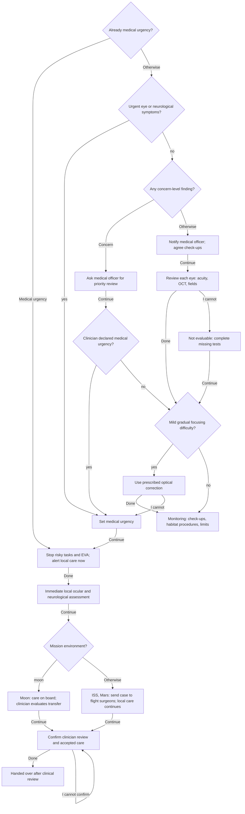
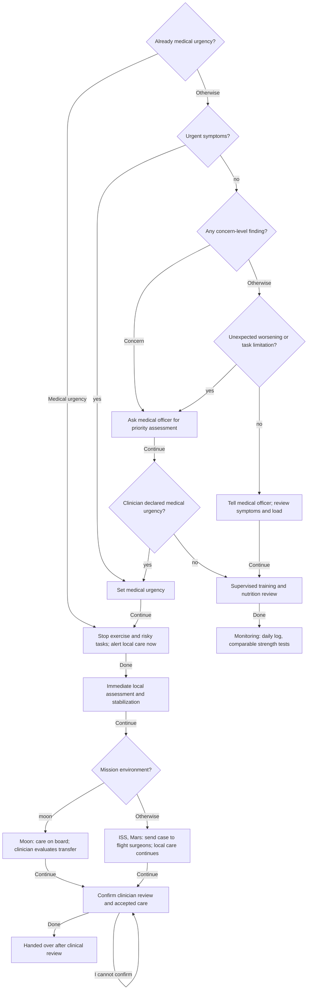

<!-- AI-assisted: generated with Codex, then reviewed and rewritten with Claude; human review by Edu pending. -->

# Regenerated treatment flowcharts (#137)

These diagrams describe `config/protocols/sans.json` and
`config/protocols/muscle_atrophy.json` node for node and edge for edge. The app
draws those same executable JSON flows through `protocol_engine.flowchart_dot()`.
The diagrams below show full paths; the app's default focused chart shows the
current step and nearby choices.

Reading the diagrams: diamonds are branching points, either a question the
astronaut answers (`yes` / `no`) or an automatic decision (`Concern`, `moon`,
`Medical urgency`, `Otherwise`). Boxes are steps shown to the astronaut, except
`w_escalate`, which only sets the severity.

## How the protocols respond

Both protocols sort a confirmed finding into the response levels of the guide.
Every branching point changes what happens next; none leads to the same action
through every outcome.

| Situation | Response | Contact | Ends as |
| --- | --- | --- | --- |
| At least one severe symptom; or the clinician declares a medical urgency after a priority review; or (SANS) no available correction restores focus | Stop risky tasks, immediate on-board assessment, episode held until a clinician accepts responsibility | Crew medical officer in every environment; flight surgeons on the ISS and on Mars, not on the Moon | `handed_over` |
| Concern-level finding; or (muscle) unexpected worsening or a task limitation | Priority clinician review. The episode waits at `w_review_outcome` until the clinician's outcome is known, then continues with supervised management | Crew medical officer | `monitoring`, unless the clinician declares an urgency |
| Watch-level finding | Routine notification and supervised management: exercise and nutrition review (muscle); result review, and prescribed optical correction only when focusing or reading is harder (SANS) | Crew medical officer | `monitoring` |
| Eye results missing or invalid (SANS) | Shown as "not evaluable", never as normal; tests completed with the clinician already involved | No additional contact | `monitoring` |

Flight-surgeon contact appears only on urgent routes, and only where the guide
directs it. Every route includes an on-board clinician contact because the
guide's first action in both states is to inform the on-board health lead, and
these protocols only run after a confirmed finding or an active urgency.

## Decisions confirmed by Edu: status after the evidence review

Kept as confirmed:

- Local crew medical officer first in every urgent route; the stop action also
  says to alert the officer immediately.
- One handover-acceptance task. `I can't` leaves that same task active; only
  `Done`, explicitly confirming clinician review and accepted responsibility,
  ends as `handed_over`. This is a crew acknowledgement, not authenticated
  clinician sign-off.
- Review corrected monocular acuity results from Check-in rather than force two
  new protocol measurements. Missing tests are not treated as normal.
- Keep supervised management and clearly labelled research/clinician-only
  treatment limits. No doses, device settings or medical waits are added.
- No `priority_review` field is introduced.

Changed by this rewrite and pending Edu's confirmation:

- **Earth support is no longer an optional question.** `u_support` asked whether
  the local clinician had requested Earth support, in every environment. The
  guide's "Aplicacion por entorno" (p. 1) is directive instead: activate remote
  medical support in Earth orbit, transmit the case on Mars, and on the Moon
  give initial care on board with no Earth contact named. `u_env` now applies
  exactly that. On the Moon, `u_moon` states that requesting Earth support
  remains the clinician's decision. To restore a Moon contact, delete the
  `moon` branch of `u_env`.
- **The same environment rule is applied to SANS.** Page 2 gives no separate
  rule for SANS; the p. 1 text is worded generally and is read here as the
  guide's environment rule for any medical urgency.
- **A priority review now has a recorded outcome.** `w_review_outcome` holds the
  episode until the clinician has reviewed it and lets the clinician escalate
  (p. 2: keep watch with priority review until assessment; the clinician may
  escalate). For muscle atrophy this applies the p. 2 rule by analogy with the
  p. 1 "valoracion prioritaria".
- **SANS optical correction depends on symptoms.** `w_symptoms` asks about mild,
  gradual focusing or reading difficulty (the guide's watch criterion).
  `w_correction` escalates when no available correction is enough, which the
  guide lists as an urgency criterion.
- **The stop action has one exit.** `u_help` duplicated the contact made in
  `u_local` and its route skipped the local assessment step.

Watch paths show five steps, counting the end message and omitting automatic
decision/severity nodes: the routine and the concern-level priority path of
each protocol. Three things each add one step: mild focusing difficulty (SANS
optical correction), missing eye results (SANS), and the task-limitation
question when it leads to a muscle priority review. Urgent paths show five
steps from an active urgency.
Ending in `monitoring` means follow-up, not cure; ending in `handed_over`
transfers responsibility after review, not resolution of urgency.

## SANS

## Muscle atrophy

## Treatment coverage against the supplied PDF

Primary source: `guia_tratamientos_vigilancia_urgencia.pdf`, 2026-11-14,
SHA-256 `7570681f75f3bed1320c607f0ad2d7387f832862397793e9069a8a0c03eae700`.
Its two-state triage and flow composition are explicitly prototype proposals,
not an official NASA treatment algorithm. The PDF's embedded implementation
suggestions do not override repository contracts.

| Pathology / source section | Covered management or limitation | Executable nodes |
| --- | --- | --- |
| Muscle, p. 1, watch activation and initial action | Tell the health lead; review symptoms, pain, real load and strength trend. Symptoms are nonspecific, so other causes are checked. | `w_report` |
| Muscle, p. 1, priority assessment and thresholds link | A concern-level finding, unexpected worsening or a task limitation gets priority assessment of capacity and cause. It is not by itself an urgency; the clinician may declare one. | `w_concern`, `w_limits`, `w_priority_review`, `w_review_outcome` |
| Muscle, p. 1, watch management | Individualized resistive and aerobic exercise; load, technique and recovery reviewed with an exercise specialist. | `w_exercise` |
| Muscle, p. 1, nutrition | Correct any energy deficit and review protein against the approved plan; no autonomous supplements or medicines. | `w_exercise`, `w_end` |
| Muscle, p. 1, monitoring and rehabilitation | Daily symptom/training records, comparable strength tests when indicated, and progressive prescribed rehabilitation after return. | `w_end` |
| Muscle, p. 1, avoid | No self-increased loads, painful training or catch-up overload. In an acute event: no maximal retesting, no forced walking or exercise. | `w_exercise`, `w_end`, `u_stop` |
| Muscle, p. 1, urgency | Sudden/progressive weakness, unsafe movement/egress, intense pain; breathing difficulty/unconsciousness are general emergencies. Stop, secure, assess and stabilize; look for injury or another acute illness instead of assuming chronic atrophy. | `w_red_flags`, `u_stop`, `u_local` |
| Both, p. 1, environments | Earth orbit: remote medical support. Mars: transmit the case, local care does not wait. Moon: care on board or in the habitat, transfer evaluated by the clinician, no automatic evacuation. | `u_env`, `u_earth`, `u_moon` |
| SANS, p. 2, watch initial action | Notify the clinician; separate-eye corrected acuity against baseline, OCT/fields when available; agree check-ups and who is responsible. Missing data is "not evaluable". | `w_notify`, `w_acuity`, `w_missing_data` |
| SANS, p. 2, watch activation | Mild gradual focusing or reading difficulty is asked about; a finding without symptoms is monitored without inventing a pathological state. | `w_symptoms` |
| SANS, p. 2, optical management | Use prescribed correction, including prescribed space-anticipation glasses; restored focus does not prove structural recovery. Correction needed beyond the available one is an urgency. | `w_correction`, `w_escalate` |
| SANS, p. 2, habitat and research / pharmaceutical limits | Sleep/habitat conditions through their procedures. LBNP, thigh cuffs and supplements are under research; acetazolamide and other drugs have no established efficacy; no established rescue drug. Nothing is started from the app. | `w_end`, `u_end` |
| SANS, p. 2, concerning finding | Priority medical review, not an automatic urgency; watch is kept until assessment and the clinician may escalate. | `w_concern`, `w_priority_review`, `w_review_outcome` |
| SANS, p. 2, urgent assessment | New field defect, central distortion, unavailable necessary correction, sudden visual loss, intense eye pain or severe headache with neurological signs: stop risky tasks/EVA, record onset and eye, local ocular/neurological assessment, consider other causes. Glasses do not replace assessment. | `w_red_flags`, `u_stop`, `u_local` |
| Both, pp. 1-2, handover | Stay assisted and retain urgency until clinician review/acceptance. Restrictions, transfer and eventual rehabilitation belong to the medical team; handover is neither cure nor automatic EVA/return authorization. | `u_handover`, `u_end` |

These cover the management categories in this PDF. They are not an exhaustive
catalogue of every therapy for every possible cause of weakness or visual loss.
A clinician chooses diagnosis-specific treatment; no generic drug doses,
exercise prescription, device settings, medical follow-up interval, automated
transfer or medication-selection menu is generated. Numeric thresholds live in
the trigger configuration, not in these protocol files.

The guide's public references (full extraction in
[MEDICAL_SOURCE_REVIEW.md](MEDICAL_SOURCE_REVIEW.md)), with what was re-checked
on 2026-11-15 for this rewrite:

1. [NASA Exercise Overview](https://www.nasa.gov/ochmo-tb-031-exercise-overview-2/): specialists build individual prescriptions; in-mission strength is to stay at or above 80 % of baseline. Checked.
2. [NASA Human Adaptation to Spaceflight: The Role of Nutrition](https://www.nasa.gov/wp-content/uploads/2024/10/human-adaptation-to-spaceflight-the-role-of-nutrition.pdf): inadequate energy intake and lean-tissue loss; adequate energy and protein come first and protein supplements are not required. Opening chapters checked; context only, not app-generated doses.
3. [NASA Astronaut Health Care in Space](https://www.nasa.gov/missions/station/faq-the-real-story-about-astronaut-health-care-in-space/): flight surgeons follow each crew during the mission; return in the crew's spacecraft if an emergency requires it; progressive reconditioning after landing. Checked.
4. [Canadian Space Agency Return and Reconditioning](https://www.asc-csa.gc.ca/eng/youth-educators/activities/fitness-and-nutrition/return-and-reconditioning.asp): educational rehabilitation context. Checked; the page gives duration, not the components of rehabilitation.
5. [NASA OCHMO-MTB-001](https://www.nasa.gov/wp-content/uploads/2024/02/ochmo-mtb-001-sans.pdf), printed pp. 12-13: prescription lenses of varying power, research countermeasures, no medication proven for SANS. Checked. In this brief the 55-micrometre and Frisen criteria appear as indications for a post-flight lumbar puncture (printed pp. 4 and 13); their use as an in-flight priority-review trigger is the guide's proposal.
6. [Gew et al., SANS consensus](https://pmc.ncbi.nlm.nih.gov/articles/PMC13462731/), DOI 10.1038/s41433-026-04651-6: space-anticipation glasses are the only established measure. Checked through the publisher page only; Table 2 could not be retrieved, so the criteria the guide tags [C] remain unverified against it.
7. [NASA Hazard: Distance From Earth](https://www.nasa.gov/hrp/hazard-distance-from-earth/): delayed remote support and the need for local capability. Checked.

None of these sources states who performs an in-flight review or defines
in-flight urgency criteria; those parts rest on the guide's own proposals.

## Validation and integration boundaries

Structural checks run on these files for this rewrite: every field and
condition against `ESTRUCTURA.md` sections 4.6 and 4.7, reachability, dead ends,
cycles, branching points whose outcomes do not differ, every route for every
environment, and equality between each diagram above and its JSON file. All
passed. The repository's own `python -m core.config --strict` and
`python -m pytest` were not run for this rewrite and remain required; tests that
name removed nodes need updating.

- Execute the routine, concern-level and task-limitation watch paths in
  ISS/Moon/Mars; confirm one local contact and no Earth contact, urgency
  escalation or new measurement on the routine watch path.
- Execute the priority review with both outcomes: `no` continues to supervised
  management, `yes` enters the urgent route with `medical_urgency` severity.
- Execute the SANS optical-correction step with both responses: `Done` ends in
  `monitoring`, `I can't` enters the urgent route.
- Execute already-urgent and newly escalated paths in every environment:
  flight-surgeon contact on ISS and Mars, none on the Moon. Repeated inability
  to confirm handover and reloads must keep the same task active. Clinical
  acceptance ends `handed_over`, retaining `medical_urgency` severity.
- Execute the SANS missing/invalid-results route. It shows "not evaluable"
  instead of assuming a normal result, without a second contact.
- Full diagrams must include all executable nodes/edges, with no unreachable
  nodes or unexpected cycles. The only allowed cycle is the intentional
  `I cannot confirm` self-edge on the one handover task; it consumes a user
  response and is not an automatic or alternating review/wait loop.
- `u_stop` no longer defines `next_if_cannot`, like `w_exercise`. Confirm the
  Protocol screen behaves the same for both.

Node changes against the previous version. Removed: `u_support`, `u_help`,
`u_orbit`, `u_mars_send`, and `u_ground` (SANS). Added: `w_review_outcome`,
`u_earth`, and for SANS `w_symptoms` and `u_moon`. Changed type:
`w_missing_data` and the muscle `u_moon` are now `info` nodes instead of
`contact` nodes.

[Issue #141](https://github.com/ansel-07/nasa-health-monitor/issues/141) tracks
Javi's separate fix: current local-contact cards display Earth round-trip delay.
Local care is immediate; an Earth signal-travel estimate is neither a local-care
wait nor a guaranteed clinical reply time. This content change does not edit
Javi's engine or UI, and cannot claim that display issue is fixed.

The existing pre-confirmation clinical-entry limitation also remains separate;
these protocols run after a confirmed numerical alert or an already active
urgency. Node changes require a fresh/reset demo session when rehearsing;
this task does not migrate old in-flight episodes pointing to removed nodes.
Gonzalo retains the final presentation/rehearsal decision. Step counts are
verified structurally, not claimed as a timed deployed 30-second rehearsal.
